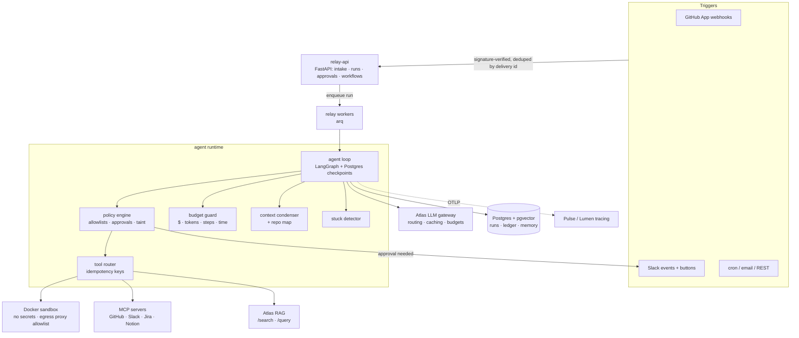

# Relay: Engineering Agent Platform

> **Status: work in progress.** The runtime core, security layer, five agent graphs, API and declarative workflows are written. The Docker Compose stack, sandbox image and end-to-end tests are not finished yet. See [Roadmap](#roadmap).

Five agent demos usually end up as five copies of the same fragile loop. Relay has **one durable, policy-enforced agent runtime** and builds **five agents** on it as configuration plus tools:

| Agent | Trigger | Output | Side effects (policy) |
|---|---|---|---|
| **Coding** | GitHub issue label `relay:fix`, Slack, API | Branch + draft PR with tests | push branch (auto), open draft PR (auto), merge (**never**) |
| **Code review** | GitHub App `pull_request` webhook | Inline comments + risk summary | post comments (auto) |
| **Support** | Slack / webhook | Cited answer (via Atlas RAG) or escalation | Jira ticket (auto), customer reply (**approval** when confidence is low) |
| **Meetings** | Recording upload | Summary, decisions, action items | Jira / Notion / Slack (**approval**) |
| **Workflows** | GitHub, Slack, email, cron events | YAML workflows with LLM steps | per-workflow policy |

## Architecture



The flow and user-flow diagrams are in [`docs/diagrams/relay-flows.drawio`](docs/diagrams/relay-flows.drawio).

## Design ideas

- **Platform first.** Each agent is a graph plus a policy file in `config/policies/*.yaml`. Budgets, approvals, sandboxing and auditing are written once, in `src/relay/core` and `src/relay/security`.
- **Durable runs.** LangGraph checkpoints live in Postgres, so a crash at step 37 resumes at step 37. Every side effect has an idempotency key, so a retry never posts twice.
- **Security by default.**
  - Prompt-injection defence with taint tracking: content read from issues, PRs or emails marks the run as tainted, and a tainted run needs approval for side effects.
  - Quarantined tool output, secret and PII scanners, and a sandbox without credentials whose network goes out only through an allowlisted egress proxy.
  - A red-team suite in `src/relay/evals/redteam.py`.
- **Cost control.** A per-run budget covers dollars, tokens, steps and wall time. Context is condensed and old tool results are cleared, and a stuck detector stops loops that repeat.
- **Measured.** `relay-eval` runs the code-review benchmark (precision and recall on seeded bugs), the agent task benchmark and the red-team payloads.

## Repository layout
```
src/relay/
  core/          agent loop, budget, condenser, idempotency, ledger, stuck detection, tool router, runs/events
  security/      policy engine, taint tracking, quarantine, scanners, analyzers
  agents/        coding · review (diff, analyzers, risk) · support · meetings · workflows (spec, engine, builtins)
  tools/         builtin tools, MCP client, integration tools, repo map
  sandbox/       sandbox provider interface + Docker provider
  integrations/  GitHub App, Slack, webhooks
  memory/        pgvector store, embeddings, consolidation
  api/           FastAPI app: runs (+SSE stream), approvals, webhooks, workflows
  evals/         review bench, agents bench, red-team payloads
config/policies/   per-agent tool allowlists and approval rules
config/workflows/  example workflows: standup digest, email triage, incident timeline, release notes, meeting → Jira
```

## API
`POST /v1/runs` · `GET /v1/runs[/{id}]` · `GET /v1/runs/{id}/events` · `GET /v1/runs/{id}/stream` (SSE) · `POST /v1/runs/{id}/cancel` ·
`GET /v1/approvals` · `POST /v1/approvals/{id}` · `POST /webhooks/github` · `POST /webhooks/slack/{events,interactions}` ·
`GET /v1/workflows[/schema]` · `POST /v1/workflows[/lint]` · `POST /v1/workflows/{name}/run`

## Development
```bash
uv sync
uv run pytest            # unit tests (policy engine)
uv run ruff check . && uv run mypy
```
Configuration comes from `RELAY_*` environment variables; see [`.env.example`](.env.example). Every LLM call goes through the [Atlas](https://github.com/Priteshverma123/atlas-rag-platform) gateway.

## Roadmap
- [ ] Docker Compose stack (api, workers, Postgres + pgvector, Redis, egress proxy, sandbox image)
- [ ] Alembic migrations and an end-to-end smoke test
- [ ] Unit tests beyond the policy engine (budget, taint, idempotency, workflow engine)
- [ ] Benchmark results: review precision/recall, agent task success rate and cost per task

Related projects: [Atlas](https://github.com/Priteshverma123/atlas-rag-platform) (RAG platform and LLM gateway) and [Lumen](https://github.com/Priteshverma123/lumen-llmops-platform) (LLMOps: observability, prompts, experiments, embeddings).
